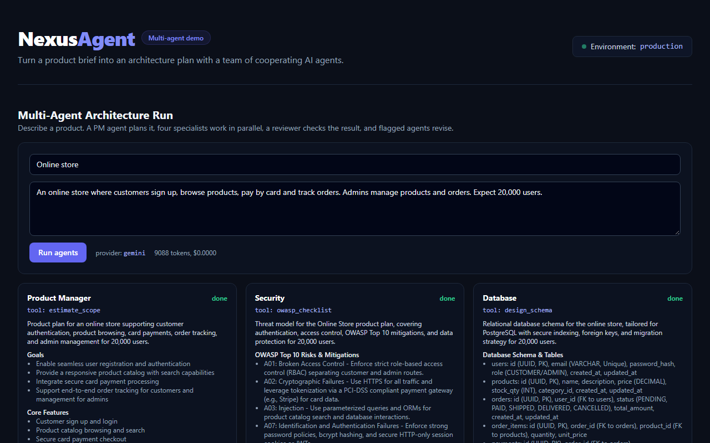

# NexusAgent Monorepo

A multi-agent AI system (brief in, architecture plan out) in a typed monorepo built with **Turborepo**, **npm workspaces**, **Next.js 15**, **Express.js**, strict **TypeScript**, and **Docker**.

## 🤖 Multi-Agent Architecture Planner

**[Live demo](https://nexusagent-usman-46c4.vercel.app)** · [Demo video](docs/demo.webm) · runs on the Gemini free tier, with an offline fallback model if the quota is used up



Submit a product brief and a team of agents turns it into an architecture plan, streamed live.

```
              ┌──────────┐
 brief ─────▶ │    PM    │  scope, features, estimate        (tool: estimate_scope)
              └────┬─────┘
        ┌──────────┼───────────┬───────────┐   run in parallel
        ▼          ▼           ▼           ▼
   ┌─────────┐ ┌─────────┐ ┌────────┐ ┌────────┐
   │Security │ │Database │ │ DevOps │ │  Cost  │   (owasp_checklist, design_schema,
   └────┬────┘ └────┬────┘ └───┬────┘ └───┬────┘    pick_infra, estimate_monthly_cost)
        └──────────┬┴──────────┴──────────┘
                   ▼
            ┌────────────┐   flags gaps ──▶ flagged agents revise once
            │  Reviewer  │
            └─────┬──────┘
                  ▼
        markdown architecture brief
```

- **Agent runtime** (`packages/agents/src/runtime.ts`): tool-use loop with a step budget, per-agent tool allow-list, Zod-validated structured output, and one automatic repair retry.
- **Providers** (`packages/agents/src/llm`): Claude (Messages API), Gemini (function calling, thought-signature round trip), or a deterministic **offline mock**. Order: Claude if `ANTHROPIC_API_KEY` is set, else Gemini if `GEMINI_API_KEY` is set, else the mock. The live demo reruns a failed real-model run on the mock and rate-limits real runs per IP to protect the free quota.
- **Live streaming**: every LLM call, tool call and result is emitted as a Server-Sent Event (`GET /api/runs/:id/events`). Late subscribers replay the log.
- **Review loop**: the Reviewer cross-checks agents against each other. In the mock run it flags the missing backup plan and DevOps revises.
- **Optional persistence**: `PERSIST_RUNS=true` writes briefs, artifacts (versioned by revision) and an audit log to Postgres through the Prisma repositories.
- **Tests**: `npm test --workspace @nexus-agent/agents` covers ordering, the revision loop, failure handling, and tool-permission checks.

### Try it

```bash
npm install
npm run build --workspace @nexus-agent/types
npm run dev          # web on :3000, API on :4000; open the page and click "Run agents"
# Real models: set GEMINI_API_KEY (free key from aistudio.google.com) or ANTHROPIC_API_KEY in apps/api/.env
#   (the web demo route reads the same variables from apps/web/.env.local)
```

```bash
curl -X POST localhost:4000/api/runs -H "content-type: application/json"   -d '{"title":"Shop","requirements":"Online store with accounts and payments for 20,000 users."}'
```

The web app also ships a self-contained `POST /api/demo-run` (Next.js route) that runs the whole pipeline inside one request and streams events back, which is what the live demo uses. The agents live in `packages/agents` and are shared by the web app and the Express API.

| Endpoint (Express API) | Purpose |
| --- | --- |
| `POST /api/runs` | Start a run (returns 202 and the run id) |
| `GET /api/runs`, `GET /api/runs/:id` | List runs, fetch a run with outputs and report |
| `GET /api/runs/:id/events` | SSE stream of agent activity |

### Roadmap

Durable job queue (BullMQ on the existing Redis), human approval checkpoints, run trace viewer, pgvector memory, evals in CI.

---

## 🏛️ Architecture Overview

```
NexusAgent/
├── apps/
│   ├── web/                     # Next.js 15 App Router Frontend (React 19, Tailwind CSS)
│   │   ├── src/
│   │   │   ├── app/             # App router pages & layouts
│   │   │   ├── components/      # Reusable React components
│   │   │   └── lib/             # Zod env validation & API clients
│   │   ├── next.config.ts       # Next.js configuration with transpilePackages
│   │   ├── tailwind.config.ts   # Tailwind CSS configuration
│   │   └── tsconfig.json        # Path alias @/* -> ./src/*
│   │
│   └── api/                     # Express.js Backend in Strict TypeScript
│       ├── src/
│       │   ├── config/          # Zod environment variable validation
│       │   ├── middlewares/     # Error handling, request validation, logging
│       │   ├── routes/          # RESTful endpoints (/api/health, /api/agents)
│       │   ├── server.ts        # Express app factory with Helmet & CORS
│       │   └── index.ts         # Server bootstrap with graceful shutdown
│       └── tsconfig.json        # Path alias @/* -> ./src/*
│
├── packages/
│   ├── types/                   # @nexus-agent/types (Shared domain models & API contracts)
│   │   ├── src/
│   │   │   ├── agent.ts         # Agent, AgentTask, AgentConfig types
│   │   │   ├── user.ts          # User and session types
│   │   │   └── api.ts           # ApiResponse, HealthResponse, PaginatedResponse
│   │   └── tsconfig.json
│   │
│   ├── tsconfig/                # @nexus-agent/tsconfig (Shared strict TS configs)
│   │   ├── base.json            # Base strict compiler configuration
│   │   ├── nextjs.json          # Preset for Next.js applications
│   │   └── node.json            # Preset for Node.js / Express applications
│   │
│   └── eslint-config/           # @nexus-agent/eslint-config (Shared linter presets)
│
├── docker-compose.yml           # PostgreSQL 16 & Redis 7 with healthchecks
├── turbo.json                   # Turborepo task pipeline configuration
├── package.json                 # Monorepo root with npm workspaces
└── README.md                    # Documentation
```

---

## 🚀 Quick Start

### Prerequisites

- **Node.js**: `v20+` (Tested on `v24.x`)
- **npm**: `v10+` (Tested on `v11.x`)
- **Docker & Docker Compose**: (Optional, for running local PostgreSQL & Redis)

### 1. Install Dependencies

Run from the monorepo root:

```bash
npm install
```

### 2. Environment Setup

Copy the example environment files:

```bash
# Root environment (Docker compose)
cp .env.example .env

# Express API
cp apps/api/.env.example apps/api/.env

# Next.js Web
cp apps/web/.env.example apps/web/.env
```

### 3. Start Database & Cache (Docker)

Start PostgreSQL 16 and Redis 7 in background:

```bash
npm run docker:up
```

Verify container health:

```bash
docker compose ps
```

### 4. Run Development Servers

Start both the Next.js frontend (port 3000) and Express API (port 4000) concurrently:

```bash
npm run dev
```

- **Web Frontend**: [http://localhost:3000](http://localhost:3000)
- **API Healthcheck**: [http://localhost:4000/api/health](http://localhost:4000/api/health)
- **Agents API**: [http://localhost:4000/api/agents](http://localhost:4000/api/agents)

---

## 🛡️ Enterprise Type Safety & Linting

This monorepo is configured with strict TypeScript compiler options:

- `strict: true`
- `noImplicitAny: true`
- `strictNullChecks: true`
- `noUncheckedIndexedAccess: true`
- `exactOptionalPropertyTypes: true`
- `isolatedModules: true`
- `forceConsistentCasingInFileNames: true`

### Run Type Checking Across All Workspaces:

```bash
npm run typecheck
```

### Production Build Across All Workspaces:

```bash
npm run build
```

### Format Code with Prettier:

```bash
npm run format
```

---

## 🔒 Runtime Environment Validation with Zod

Both applications fail fast on startup if required environment variables are absent or fail validation:

### Backend (`apps/api/src/config/env.ts`)

Validates:

- `PORT` (positive integer, default: `4000`)
- `NODE_ENV` (`development | test | production`)
- `CORS_ORIGIN` (allowed origins)
- `DATABASE_URL` (PostgreSQL connection URL)
- `REDIS_URL` (Redis connection URL)

### Frontend (`apps/web/src/lib/env.ts`)

Validates:

- `NEXT_PUBLIC_API_URL` (valid URL targeting Express backend)
- `NEXT_PUBLIC_APP_ENV` (`development | staging | production`)
- `NODE_ENV`

---

## 📦 Shared Types Package (`@nexus-agent/types`)

All domain models, API responses, and healthcheck contracts are centralized in `packages/types`.
Both `apps/web` and `apps/api` import directly:

```typescript
import type { Agent, ApiResponse, HealthResponse } from "@nexus-agent/types";
```

---

## 🐳 Docker Infrastructure Reference

| Service        | Image                | Host Port | Container Port | Health Check     |
| -------------- | -------------------- | --------- | -------------- | ---------------- |
| **PostgreSQL** | `postgres:16-alpine` | `5432`    | `5432`         | `pg_isready`     |
| **Redis**      | `redis:7-alpine`     | `6379`    | `6379`         | `redis-cli ping` |

Persistent data volumes:

- `postgres_data`
- `redis_data`
